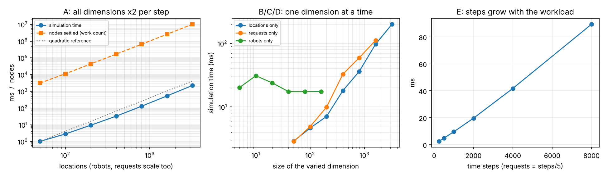

**Group members:** _(fill in names / roll numbers)_  **Submission 2 deadline:** 26 November 2026

# 1. Introduction and Problem Overview

After a disaster, roads are blocked, charging stations fail, robots break down and new rescue requests keep arriving. A fleet of autonomous robots must be coordinated so that urgent requests are served quickly, no request is served twice, no robot is asked to do something it cannot do, and the whole operation can be reproduced and audited. This project is a C++ simulator of such a coordination centre. It reads a complete scenario from a text file, runs it in discrete time steps and writes a machine-readable record and final statistics.

The system has to answer, over and over, a small set of questions, and the data structures were chosen from them:

| Question the system must answer | How often |
|---|---|
| What is the internal object for external id *x* (location, connection, robot, request)? | on load and for every event |
| What are the neighbours of a location? Block or unblock a connection. | every route query; every event |
| What is the cheapest route over the roads that are currently open? | every assignment and every reroute |
| Which waiting request has the highest priority? | every step |
| Which events / reports are due now, in file order for equal times? | every step |
| How far is the nearest working charger from here? | every assignment |
| Record every state change. | every transition |

All core data structures (dynamic array, hash map, binary heap, stable sort, graph) are implemented by us. **No STL container and no `std::string` is used anywhere**; the test suite scans the source to prove it. The program is modular, handles memory with RAII, and never needs a source change to run a different scenario.

# 2. Objectives and Scope

**Objectives (from the project brief) and where they are met.**

| Objective | Realised by |
|---|---|
| Represent the environment so locations, connections and restrictions can be queried efficiently | `Environment`: CSR adjacency lists, O(1) block/unblock, hash map for ids |
| Manage robots with states, capabilities, locations, resources | `Robot` record with an explicit state machine, battery and capability |
| Accept and maintain requests that arrive over time | `Request` lifecycle state machine; stably sorted report list |
| Valid routes that respect blocked connections | Dijkstra over open connections only |
| Coordinate competing robots / requests | deterministic priority queue + candidate rule (§4) |
| At least one meaningful environmental change affecting later decisions | `BLOCK/UNBLOCK`, `STATION_DOWN/UP`, `SET_URGENCY`, `ROBOT_OFFLINE/ONLINE` events |
| Deterministic, chronological simulation | fixed processing order inside a step (§4.1) |
| Evidence of correctness, scalability, efficiency | §8 (performance), §9 (testing), §10 (results) |

**Scope and decisions we documented.** Connections are **undirected**. One time step is one unit of simulated time. Planning (route search, assignment) takes no simulated time; moving and working do. The route criterion is minimum total cost. Rescue work is not shared: one robot serves one request at a time, and interrupted work restarts from zero. The input format is exactly that of `scenario_provided.txt` plus five optional extra `PARAM`s (§7.4).

**Out of scope.** Globally optimal assignment, robots cooperating on one request, partial progress hand-over, and a graphical interface.

# 3. Data Structures and Data Representation

## 3.1 Overview

```
            scenario file (text)
                   |
          scenario.cpp  (loader + validator, line-numbered errors)
                   |
   Scenario = Params + Environment + Robots[] + Requests[] + Events[]
                   |  (copied into)
             simulation.cpp -- step = EVENTS -> REPORTS -> DISPATCH -> ROBOTS -> CHECK
        uses  environment.cpp (graph, Dijkstra, multi-source charger distances)
              robot.cpp / rescue_request.cpp (state machines)
              min_heap.h  sort_util.h  int_map.h  vector.h        logger.cpp (CSV record)
                   |
             main.cpp (CLI: run / --steps / --interactive / --validate / --show / --check)
```

## 3.2 Representation of each component

| Component | Representation | Why it fits | Operations (cost) | Space |
|---|---|---|---|---|
| `Vector<T>` | contiguous array, size and capacity (doubling from 8); copy constructor/assignment, move, destructor (rule of five) | base of everything; cache-friendly; no leaks; copies are deep | `pushBack` O(1) amortised, `[]` O(1), `resize` O(n), `reverse` O(n) | O(n) |
| `IntMap` (id → index) | open addressing, linear probing, power-of-two table, integer mixing hash, grows when more than half full | ids in the file are arbitrary integers (not dense); expected O(1) lookup and no per-node allocation | `insert`, `get`, `contains`: O(1) expected | O(n) |
| `MinHeap<T,Less>` | binary heap stored in a `Vector` | Dijkstra frontier and dispatch order | `push`, `pop` O(log n); `top` O(1) | O(n) |
| `stableSort` | bottom-up merge sort with one temporary buffer | records that share a time step must keep file order → the sort must be **stable** | O(n log n) | O(n) |
| `Environment` | undirected graph: dense arrays of locations and connections; **adjacency lists in compressed (CSR) form** (`offsets_` of size V+1, `adj_` of size 2E holding connection indices); a `blocked` flag per connection; a `stationUp` flag per charging station; a `version_` counter that grows on every change that can alter routes | neighbours of a node are one contiguous slice; blocking/unblocking is **one flag write** — the structure is never rebuilt when the world changes | neighbours O(deg); block/unblock O(1); id lookup O(1) | O(V + E) |
| `Robot` | struct: id, location, capability, battery, state (enum), current request, **remaining route** (`Vector<int>` of connection indices + position), road progress (`edgeRemaining`, `nextNode`), work left, statistics | everything the engine needs per robot in one place; route replaced wholesale on a reroute | O(1) access; route O(length) | O(R + total route length) |
| `Request` | struct: id, report time, location, category, urgency, duration, **state (enum)**, holding robot, timing fields | lifecycle enforced by a transition table | O(1) | O(Q) |
| Pending requests | no separate container: at each dispatch the PENDING ones are pushed into a `MinHeap` ordered by *(effective urgency ↓, report time ↑, id ↑)* | urgency changes by event and aging changes with time, so the order is rebuilt from current values — no stale priorities | build O(P log P), pop O(log P) | O(P) |
| Events and reports | arrays stably sorted once on load, consumed with a cursor | each record is touched once; same-time records keep file order | O(n log n) once, O(1) per step amortised | O(n) |
| Route caches | per robot: distance and predecessor arrays of the last search from the robot's location, valid while the robot stays put and `env.version()` is unchanged | repeated dispatch passes reuse the search (§4.4) | O(1) check | O(R′·V), R′ ≤ R robots that have been idle with work waiting |
| Charger-distance map | one array: distance from every node to the nearest UP charger, valid for one `env.version()` | the battery reserve of a job is an O(1) lookup | O(1) lookup | O(V) |
| `Logger` | buffered CSV writer | machine-readable record | O(1) per record | O(1) |

## 3.3 State machines

*Request:* `NOT_REPORTED → PENDING → ASSIGNED → IN_PROGRESS → COMPLETED`; `ASSIGNED/IN_PROGRESS → PENDING` (released); `FAILED` from `NOT_REPORTED` or `PENDING`. `COMPLETED` and `FAILED` are terminal.
*Robot:* `AVAILABLE, TRAVELLING, PERFORMING, RETURNING, RECHARGING, UNAVAILABLE` with an explicit table of allowed transitions (e.g. `UNAVAILABLE → AVAILABLE` only; `PERFORMING` can only end in `AVAILABLE` or `UNAVAILABLE`). Both tables are unit-tested. An attempt to make an illegal transition is **rejected, counted and logged** (`REJECTED`) instead of corrupting the state.

# 4. Algorithms and Route/Coordination Strategy

## 4.1 One time step (fixed order, applied consistently)

1. **Events** with `time ≤ t`, in file order.
2. **Reports**: requests with `report_time ≤ t` become PENDING, in file order. A request whose category no robot in the fleet can ever serve is FAILED immediately.
3. **Dispatch**: pending requests, highest priority first, are matched to idle robots (§4.3).
4. **Robots**: every robot, in ascending robot id, advances one step (move, work, recharge, or head to a charger).
5. **Termination check**: `max_steps` reached, or (default) every request is COMPLETED or FAILED.

A step is one unit of simulated time. A robot moves up to `speed` cost units per step, uses `battery_per_cost_unit` battery per cost unit, and performs one unit of work per step using `battery_per_work_step`. At an UP charging station it gains `recharge_per_step` per step up to its maximum.

## 4.2 Route selection

The criterion is **minimum total connection cost** over currently OPEN connections, found with **Dijkstra's algorithm** using our binary heap and lazy deletion of stale entries. Ties are resolved deterministically by (distance, node index) in the heap and by adjacency order. A search can stop early once every node it was asked about has been settled; the values of settled nodes are then exact (verified against full searches by a randomised unit test).

## 4.3 Dispatch (coordination and conflicts)

Pending requests are taken in the order **effective urgency (high first) → report time (earlier first) → request id**. Effective urgency is the urgency, plus (only if `aging_steps = n > 0`) one level per `n` steps the request has waited — this prevents starvation of low-urgency requests. The order is a strict total order, so it is deterministic.

For each request, the **candidate robots** are those that are idle (AVAILABLE or RECHARGING, online, standing on a node), **capable** (`GENERAL` serves any category), able to **reach** the request over open roads, and with **enough battery** for *route + the work + the trip from the request to the nearest UP charging station* (the "reserve"). Among candidates the robot with the **cheapest route** is chosen; ties go to a specialist over a `GENERAL` robot, then to the lowest id. If two or more candidates exist, a *conflict* is counted and logged. The same robot can be a candidate for several requests (a "contested robot"); the priority order decides who gets it. A request nobody can take stays PENDING and is retried at every dispatch (for example while its location is cut off, or while every capable robot is busy or charging).

## 4.4 Two route-search strategies (chosen per dispatch pass for speed)

The dispatch needs the route cost from each candidate robot to each request. Because roads are undirected, a search rooted at *either* end gives the answer:

* **Per-request search** — one early-exit Dijkstra rooted at the request that stops once all idle capable robots are settled. Cost ≈ one search per request.
* **Per-robot search** — one full Dijkstra rooted at each idle robot, **cached** while the robot stays where it is and the roads do not change. Cost ≈ one search per idle robot, no matter how many requests wait.

The engine uses the per-robot strategy when **more requests are waiting than robots are idle**, and the per-request strategy otherwise. The choice depends only on the state, so it is deterministic; it affects speed, not correctness (§8.4, §9). The battery reserve uses a third structure shared by both: **one multi-source Dijkstra from all UP chargers** gives the distance to the nearest charger for every node, recomputed only when a road or station changes.

## 4.5 Dynamic conditions and policies

| Change | Policy |
|---|---|
| Road **blocked** while a robot is travelling | The robot finishes the road it is on (it cannot turn around). At the next node it checks its next connection; if blocked it **re-plans** from where it is (`REROUTE`). If there is no alternative route, or the new route is not affordable, the request is **released** to PENDING (reassignment +1) and the robot becomes AVAILABLE. |
| Road **restored** | Routes in progress are not re-optimised; pending requests are re-planned at every dispatch, so the road is used from the next step. |
| Station **down** | Robots recharging there stop; robots heading there re-plan to the nearest UP station. |
| Robot **offline** | Its request is released immediately; the robot is UNAVAILABLE (frozen where it is, or on its current road). When online again it becomes AVAILABLE. Interrupted work restarts from zero. |
| **Urgency changed** | Takes effect at the next dispatch (ignored, and logged as such, if the request is already finished). |
| Request at a **cut-off location** | Stays PENDING until a connection is restored. |

**Charging.** An idle robot goes to the nearest UP station when it is below `low_battery_pct` of its maximum, or when a pending request is infeasible only because of its battery. A recharging robot can still be assigned as soon as its battery suffices. A request fails after more than `max_reassign` releases, or immediately if no robot can ever serve its category.

# 5. Design Decisions and Alternatives

| Decision | Chosen | Alternative considered | Why the choice |
|---|---|---|---|
| Graph storage | adjacency list (CSR) | adjacency matrix | A matrix needs O(V²) memory (10⁶ cells for 1000 locations with only 2500 roads) and O(V) to list neighbours; CSR is O(V+E) and neighbours are contiguous. |
| Route queries | Dijkstra on demand | precompute all pairs (Floyd–Warshall O(V³), or V Dijkstras) | Roads block and reopen during the run (up to 107 environment changes in the hard scenario); a precomputed table would be invalidated constantly. On demand we pay only for queries that are needed, and caches are keyed on `env.version()`. |
| Shortest-path algorithm | Dijkstra | BFS, A* | BFS ignores costs; A* needs coordinates for a heuristic and the input has none. |
| Priority structure | binary heap, rebuilt from current values each dispatch | sorted array kept incrementally; linear scan for the maximum | Urgency and aging change over time, so a persistent order would go stale; a sorted array costs O(n) per insert and a scan O(n) per extraction. |
| Id lookup | own hash map | arrays indexed by id; linear search | ids are arbitrary integers, so direct indexing can waste memory or fail; linear search makes loading O(n²). |
| **Where to root route searches** | automatic per pass: per-robot (cached) under overload, per-request otherwise | always per request (our first design); always per robot | *Measured:* always-per-request needed **343,941 searches / 7.2 s** for 1,600 requests on 20 robots; always-per-robot is up to **11× slower** when 160 robots are idle and few requests arrive. The hybrid needs **1,599 searches / 0.11 s** in the first case and stays within ~12 % of the best in the second (§8.4). |
| Battery reserve | one cached multi-source search from all chargers | one search per request to find the nearest charger | the reserve becomes an O(1) lookup, recomputed only when roads or stations change. |
| Assignment | online greedy by priority, cheapest robot per request | optimal matching (Hungarian algorithm, O(n³)) or min-cost flow | Requests arrive over time and the decision must be reproducible step by step; greedy is O(P·I) per step, deterministic and easy to explain. Optimal matching would also need a definition of what to optimise (urgency-weighted response time?) that the brief does not give. |
| Event / report order | stable merge sort | unstable sort | An unstable sort can reorder records with equal times and change results. |
| Invalid state changes | explicit transition tables that reject and log | trust the engine's logic | Makes inconsistency visible: the rejected-actions counter is 0 in every run, and the unit tests exercise the tables directly. |
| Dynamic memory | RAII `Vector`, no owning raw pointers elsewhere | manual `new`/`delete` in each module | One audited place does allocation; all containers copy and move correctly; AddressSanitizer reports no leaks or errors. |

# 6. Complexity Analysis

Notation: V locations, E connections, R robots, Q requests (P of them pending at a given step, I robots idle), T steps, D the length of a route in connections, S the number of shortest-path searches run.

| Operation | Time | Space |
|---|---|---|
| Load and validate | O(size of file) parsing and hash look-ups, O(E) to build adjacency, O(Q log Q + Ev log Ev) for the stable sorts | O(V + E + R + Q + Ev) |
| Dijkstra (binary heap, lazy deletion) | O((V + E) log V) (the heap never holds more than O(E) entries, and log E = O(log V)); early exit makes it smaller | O(V) |
| Multi-source charger distances | O((V + E) log V), only after a road/station change | O(V) |
| Block / unblock / station change | O(1) (plus O(R·D) when the BLOCK is logged, to count affected routes) | — |
| One dispatch pass | O(Q) to collect pending + O(P log P) heap + for every request taken from the heap: O(I) candidate scan, and O(Q) to detect a "contested" robot if it is assigned; plus the searches below | O(P) |
| Searches in a pass (per-robot strategy) | at most one full search per idle robot whose cache is stale; cached across steps | O(R′·V) |
| Searches in a pass (per-request strategy) | at most one early-exit search per pending request that has a free capable robot | O(V) |
| Robot update per step | O(R) (+ one search when a robot reroutes or looks for a charger) | — |
| **Whole run** | **O(T·(R + Q) + P log P per step + S·(V + E) log V)** | **O(V + E + R + Q + R′·V)** |

**How S behaves.** S is of the order of one search per assignment, reroute or return-to-charger, plus one per road change: 1.3 searches per request in experiment A at 3,200 requests (4,172 searches), a few per request when robots are few (experiment B, 100 requests, 10 robots: 300–500 searches). Under overload it is bounded by the number of robots, not of requests (1,599 searches for 1,600 requests on 20 robots). Because each search touches O(V + E) nodes and the number of requests also grows with the instance, **scaling the whole instance gives roughly quadratic growth** in time; scaling only the number of time steps gives linear growth. §8 confirms both with measurements.

# 7. Implementation Details

## 7.1 Modules

| File | Responsibility |
|---|---|
| `vector.h`, `int_map.h`, `min_heap.h`, `sort_util.h` | our dynamic array, hash map, heap, stable merge sort |
| `types.*` | enumerations (categories, capabilities, states, events) and name conversion |
| `environment.*` | locations, connections, CSR adjacency, blocked flags, stations, Dijkstra (with early exit), multi-source charger distances, work counters |
| `robot.*`, `rescue_request.*` | the two records and their state machines |
| `scenario.*` | line-by-line parser and validator (`LoadReport` with line numbers) |
| `simulation.*` | time stepping, events, dispatch, movement, charging, statistics, invariant checker |
| `logger.*` | CSV record |
| `main.cpp` | command line: run, `--steps`, `--interactive`, `--show`, `--validate`, `--check` |
| `tools/gen_scenario.cpp` | deterministic scenario generator (own random number generator; profiles `normal`, `easy`, `hard`) |

## 7.2 Safety and robustness

* Memory is owned only by `Vector` (RAII, rule of five). `make test` runs everything under **AddressSanitizer and UndefinedBehaviorSanitizer**; no error or leak is reported.
* The loader never crashes on bad input: strict integer parsing with range checks, bounded line length, bounded token count, cross-reference checks after parsing, at most 100 messages per category. Errors carry line numbers; an invalid scenario is never run.
* Every ordered structure has a strict total order (priority, heap tie-break, robot id), so runs are **deterministic**: the same input gives a byte-identical record (tested).
* `--check` runs an **invariant checker** after every step: robot/request links are mutual, robot and request states agree, battery stays within [0, maximum], recharging only at stations, the terminal-request counter is right.

## 7.3 Output

The simulation record is a CSV: `time,event,robot,request,object,value,detail` with 25 event types (full table in the README) covering state changes of robots and requests, assignments, conflicts, every movement along a connection, reroutes, failures and rejected actions, environment changes, and final statistics (`FINAL_STAT`, one `FINAL_ROBOT` line per robot). The final statistics (also printed) contain: requests completed / failed / remaining; average and maximum response time and response time per urgency level; robot utilization; distance; battery used and recharged; assignments, reassignments, reroutes; conflicts; environment changes; rejected actions; route-search work counters; execution time; and a per-robot table.

## 7.4 Input format and extensions

The input is exactly `scenario_provided.txt`'s format. Our optional `PARAM` extensions (defaults keep the provided file's behaviour): `stop_when_done` (1), `max_reassign` (5), `low_battery_pct` (50), `aging_steps` (0 = off), `route_strategy` (0 = automatic). All are documented in the README, and unknown keys only produce a warning.

# 8. Performance and Scalability Analysis

**Method.** `tools/benchmark.sh` (run with `make bench`) generates scenarios with the deterministic generator, runs each one five times and records the **median** simulation time (loading excluded), plus *work counters* that do not depend on the machine: number of route searches, nodes settled, connections scanned. Timing was done in a 2-core cloud container, so absolute times on another computer will differ; the shapes and the counters will not. All runs complete with 0 rejected actions.

## 8.1 Everything grows together (experiment A, 500 steps; robots = locations/5, requests = locations)

| Locations | Connections | Robots | Requests | Searches | Nodes settled | Simulation time | Load + validate |
|---|---|---|---|---|---|---|---|
| 50 | 110 | 10 | 50 | 78 | 3,133 | 1.0 ms | 0.09 ms |
| 100 | 220 | 20 | 100 | 148 | 11,270 | 2.8 ms | 0.14 ms |
| 200 | 440 | 40 | 200 | 274 | 43,874 | 9.4 ms | 0.24 ms |
| 400 | 880 | 80 | 400 | 526 | 168,794 | 32.8 ms | 0.47 ms |
| 800 | 1,760 | 160 | 800 | 1,038 | 656,135 | 128.9 ms | 0.85 ms |
| 1,600 | 3,520 | 320 | 1,600 | 2,059 | 2,593,797 | 533.7 ms | 1.7 ms |
| 3,200 | 7,040 | 640 | 3,200 | 4,172 | 10,292,439 | 2,238 ms | 3.6 ms |

Doubling every dimension multiplies the work by about 4 (the fitted exponent of time against size is **1.85**, i.e. roughly quadratic), exactly as the analysis predicts: the number of searches grows ×53 over the table and the nodes covered by each search ×62, so the total work (nodes settled) grows ×3,285, close to 64² = 4,096. Loading is almost linear (exponent 0.88). The instance in the last row (3,200 locations, 7,040 connections, 640 robots, 3,200 requests) is 64 times the size of the minimum working scenario in every dimension and runs in about 2 seconds.

## 8.2 One dimension at a time and the number of steps

| Experiment | Varied | Result |
|---|---|---|
| B | locations 50 → 3,200 (10 robots, 100 requests) | 2.9 ms → 200.7 ms; the number of searches stays ≈ 300–500 (it follows the 100 requests), the work per search grows with V |
| C | requests 50 → 1,600 (200 locations, 20 robots) | 2.9 ms → 111.8 ms. Up to 200 requests everything is served; at 400+ the 20 robots **saturate** (365, 464, 574 completed) and the work stops growing with the requests (searches 1,082 → 1,599) |
| D | robots 5 → 160 (400 locations, 200 requests) | 20.2 → 31.0 ms with 5–10 robots (overloaded: only 99–173 of 200 requests finish), then ≈ 17.5 ms from 40 robots on: more robots than needed cost almost nothing |
| E | steps 250 → 8,000 with the workload (requests = steps/5) | 2.4 ms → 89.5 ms; exponent **1.04** — linear in the number of steps |



Writing the record costs little: for the 3,200-location run the time without a record is 2,198 ms against 2,238 ms with one (about 2 %).

## 8.3 The five scenarios of the project

| Scenario | Size (L / E / R / Q / steps) | Simulation time | Route searches |
|---|---|---|---|
| provided (minimum working) | 56 / 117 / 12 / 60 / 250 (stops at 204) | 1.2 ms | 198 |
| level 1 easy | 60 / 130 / 12 / 60 / 250 | 1.1 ms | 79 |
| level 3 hard | 100 / 215 / 8 / 110 / 400 | 9.0 ms | 645 |
| stress | 120 / 260 / 24 / 120 / 600 | 4.1 ms | 179 |
| scale 1000 | 1,000 / 2,500 / 50 / 500 / 1,000 | 149 ms | 718 |

## 8.4 A bottleneck found by measurement, and the fix

Profiling the first complete version showed that **100 % of the time was spent in the shortest-path search**, and the benchmark exposed a bad case: when many more requests are waiting than there are robots (experiment C), the first design ran one search **per pending request at every step**, even when no robot could take it. Searches grew to 343,941 and the run took 7.2 s for 1,600 requests on 20 robots. We replaced it by the hybrid of §4.4 (search per *idle robot*, cached; charger distances from one multi-source search). Result, same inputs:

| Case | Before: searches, time | After: searches, time | Speed-up |
|---|---|---|---|
| C: 400 requests, 20 robots | 24,912 — 476 ms | 1,082 — 33 ms | 14× |
| C: 800 requests, 20 robots | 123,488 — 2,498 ms | 1,505 — 61 ms | 40× |
| C: 1,600 requests, 20 robots | 343,941 — 7,214 ms | 1,599 — 112 ms | **64×** |
| D: 5 robots, 200 requests | 15,792 — 500 ms | 295 — 20 ms | 25× |
| B: 3,200 locations | 1,879 — 552 ms | 419 — 201 ms | 2.7× |
| A / E (light load) | about the same number plus one per road change | 5–20 % slower than before | none: the small price of the charger-distance map |

The first fix tried — stopping each search as soon as all needed robots and the nearest charger were reached — gave only 15–20 %, because the number of searches was already close to one per assignment; the counters made it clear that the remaining cost came from *how many* searches were run, not from how long each one ran. Forcing one strategy everywhere shows why a hybrid is needed: always-per-robot is up to 11× slower than per-request when 160 robots are idle and few requests arrive.

# 9. Testing and Verification

`make test` runs the following (all must pass; about 15 seconds).

| Kind | What is checked |
|---|---|
| Unit tests (**20,357 checks**) | `Vector` (copy, move, aliasing push, resize, nested vectors), `IntMap` (20,000 keys, duplicates, misses), `MinHeap` against a sorted reference, `stableSort` stability, state-machine tables, loader facts for the provided file (56 locations, 117 connections, 7 blocked, 12 robots, 60 requests, 20 events; location 7 cut off) |
| Routing | **Dijkstra against Floyd–Warshall** on 60 random graphs with blocked edges (distances *and* reconstructed routes); **early-exit search against full search** on 80 random graphs (targets and nearest charger); blocking changes routes |
| Behaviour | every scenario completes with the expected outcome: 5 of 6 completed + 1 FAILED in the conflict scenario; one reroute in the reroute scenario; one reassignment in the battery scenario; aging makes request 1 be assigned at t = 41 instead of t = 63; an urgency event changes the dispatch order; overloaded scenario leaves requests unresolved without any inconsistency |
| Invariants | `--check` after every step of every scenario: robot/request links mutual, states consistent, battery in range; **rejected actions = 0** in every run |
| Strategies | per-request, per-robot and automatic search strategies give the same completed / failed / assignments / distance / reassignments on six scenarios |
| Invalid input | **34 malformed files** (counts too high/low, missing sections or `END`, duplicate ids, dangling references, bad numbers, out-of-range values, wrong field counts, trailing content, …) are all rejected with exit code 1 and no sanitizer report |
| Golden regression | the provided scenario's record and statistics must equal the stored reference in `tests/golden/` |
| Determinism | repeated runs give byte-identical records (provided, stress, hard, 1000-location) |
| Record format | 7 columns on every line; every event type occurs in the provided run |
| **Sanitizers** | unit tests and all scenarios under AddressSanitizer + UBSan: no memory error, leak, overflow or undefined behaviour |
| **Mutation fuzzing** | random corruptions of scenario files (deleted, duplicated, swapped lines; tokens replaced by garbage or extreme numbers; truncation; flipped bytes; 3,000-character lines). A long campaign of **160,000 mutants** over 8 scenarios under the sanitizers: about 12,350 were accepted by the validator and simulated for up to 400 steps with the invariant checker, the rest were rejected; **no crash, hang, sanitizer report or invariant violation** |
| Source scan | no STL container header and no `std::` container / `std::string` in `src/`, `tools/`, `tests/` |

One limitation of the strategy test is worth stating: when two routes have exactly the same cost, the per-request and per-robot searches may choose different ones, and a later road event can then affect the two robots differently. In a comparison of the three strategies on 24 randomly generated scenarios, 23 gave identical statistics and one differed slightly (82 vs 81 requests completed). We traced that case to a tie (the same robot assigned at the same cost 19 over a 4-edge and a 5-edge route). A given strategy always makes the same choice.

# 10. Results

## 10.1 Scenarios of increasing difficulty

| Scenario | Completed | Failed | Unresolved | Avg / max response | Utilization | Distance | Assign. / reassign. / reroutes | Env. changes |
|---|---|---|---|---|---|---|---|---|
| tiny | 6 / 6 | 0 | 0 | 9.2 / 19 | 56.8 % | 48 | 6 / 0 / 0 | 2 |
| reroute | 3 / 3 | 0 | 0 | 20.0 / 41 | 21.9 % | 21 | 3 / 0 / 1 | 3 |
| conflict | 5 / 6 | 1 | 0 | 7.0 / 13 | 75.9 % | 20 | 5 / 0 / 0 | 1 |
| battery | 2 / 2 | 0 | 0 | 24.0 / 48 | 19.8 % | 30 | 3 / 1 / 0 | 3 |
| aging | 32 / 32 | 0 | 0 | 3.7 / 42 | 100 % | 3 | 32 / 0 / 0 | 0 |
| **Level 1 – easy** | 60 / 60 | 0 | 0 | 10.8 / 25 | 27.3 % | 715 | 60 / 0 / 0 | 11 |
| **Level 2 – provided** | 60 / 60 | 0 | 0 | 14.2 / 92 | 42.2 % | 871 | 62 / 2 / 0 | 18 |
| **Level 3 – hard** | 77 / 110 | 0 | 33 | 134.4 / 372 | 39.7 % | 1,271 | 85 / 4 / 0 | 107 |
| stress | 120 / 120 | 0 | 0 | 9.3 / 21 | 12.0 % | 1,380 | 120 / 0 / 1 | 56 |
| medium | 80 / 80 | 0 | 0 | 9.3 / 23 | 20.2 % | 869 | 80 / 0 / 0 | 34 |
| scale 1000 | 500 / 500 | 0 | 0 | 11.2 / 23 | 16.1 % | 6,707 | 503 / 3 / 1 | 99 |

Difficulty rises from level 1 to level 3 as intended: response time grows from about 11 to 134 steps, and at level 3 the system is overloaded — 33 of 110 requests are still unresolved after 400 steps because batteries are small (robots spend much of their time recharging; at the end three robots are recharging at 11–12 battery, too little to take a job), two locations start cut off, 28 roads start blocked, and some categories have only one or two robots (at the end 9 SEARCH and 10 SUPPLY requests are pending, and only two robots can serve each of those categories). It degrades gracefully: no inconsistent state, no rejected action, every request is either served, or waiting.

## 10.2 The provided scenario (`output/scenario_provided_record.csv`, `output/scenario_provided_stats.txt`)

* All **60 requests completed** in 204 steps (the run ends early because all requests are resolved; `max_steps` is 250). Average response 14.2 steps, maximum 92.
* **Cut-off location:** request 9 (at location 7, all of whose three connections start BLOCKED) waits until connection 11 reopens at t = 60 and is then assigned to robot 2; robot 2 goes offline at t = 80, the request is released and re-assigned to robot 3, which arrives at t = 101 (first work step t = 102, completed t = 104). That explains the maximum response time of 92 (102 − 10).
* **Dynamic events:** 19 of the 20 events were processed (5 BLOCK, 5 UNBLOCK, 2 STATION_DOWN, 2 STATION_UP, 2 ROBOT_OFFLINE, 2 ROBOT_ONLINE, 1 SET_URGENCY); the last event (t = 210) lies after the run ended. Robots 2 and 7 went offline holding requests 9 and 42, which were released and re-assigned (2 reassignments). The `SET_URGENCY 21 5` event at t = 75 arrives after request 21 was already completed (t = 50) and is therefore logged as ignored.
* 62 assignments, 37 requests with two or more candidate robots (conflicts), 871 cost units travelled, 871 battery for travel + 608 for work, 950 recharged, robot utilization 42.2 %, 0 rejected actions, 198 route searches, execution time about 1 ms.

## 10.3 Demonstrations of dynamic behaviour

* **Reroute (`scenario_reroute.txt`):** robot 1 travels 1→2→3→4; connection 3–4 is blocked at t = 4; the robot notices at node 3 at t = 6 and re-plans via 2→5→4 (`REROUTE`, cost 11); the request at the cut-off location 7 waits until t = 40 when the road opens.
* **Charging and offline (`scenario_battery.txt`):** robot 1 has too little battery and goes to charge; its charger goes DOWN at t = 6 so it diverts to the other charger (`RETURN_TO_CHARGER`, 12 cost units); robot 2 goes offline in the middle of work and its request is re-assigned and later completed by robot 1.
* **Priority and conflicts (`scenario_conflict.txt`):** two FIRE robots compete for three FIRE requests reported at the same step; request 3 (urgency 1) is raised to 5 at t = 3 and is then served before request 4; without the event the order is reversed (verified by a test). The SUPPLY request fails at once because no robot can serve SUPPLY.
* **Aging (`scenario_aging.txt`):** one robot, one urgency-1 request, a stream of urgency-5 requests every 2 steps. Without aging the urgency-1 request waits until the stream ends (assigned at t = 63, first work step 64); with `aging_steps 10` it is assigned at t = 41 (first work step 42).

# 11. Limitations and Future Work

* **Greedy matching** (priority order, cheapest robot per request) is deterministic and explainable but not globally optimal; a batch assignment with an explicit objective could lower total response time.
* **Returning robots are not pre-empted:** a robot on its way to a charger finishes that trip even if an urgent request appears. This protects battery safety but costs response time.
* **Interrupted work restarts from zero** when a robot goes offline.
* **Equal-cost routes:** which one is used depends on the search strategy (§9); results remain deterministic for a given strategy.
* **Super-linear scaling:** since each assignment needs a shortest-path search, work grows roughly quadratically when the whole instance is scaled (exponent 1.85 measured). A multi-robot search sharing one frontier, or hierarchical routing, would reduce it.
* **Memory of route caches** is O(R′·V) in the worst case (R′ robots, V locations), about 25 MB for the largest benchmark; it could be bounded with a least-recently-used policy.
* **Priority without aging** (the default, which reproduces the provided scenario's behaviour) can delay low-urgency requests indefinitely under a continuous stream of urgent ones; `aging_steps` removes this and is demonstrated.
* The "contested robot" statistic counts assignments where the robot was also category-compatible with another pending request; it is an indicator, not a feasibility-checked measure.

# 12. Conclusion

We built a complete, modular, deterministic rescue-coordination simulator on top of data structures written from scratch — dynamic array, hash map, binary heap, stable sort and a CSR graph — with explicit state machines that reject invalid transitions. It loads any scenario in the provided format, validates it with line-numbered errors, and handles blocked roads (including while robots travel), station failures, robot outages and priority changes. Route selection uses Dijkstra with a documented criterion; dispatch uses a deterministic priority order, a documented candidate rule and a battery-safe reserve.

The evidence is quantitative: 20,357 unit checks, Dijkstra verified against Floyd–Warshall, sanitizer-clean runs of every scenario, a golden regression of the provided scenario, and a 160,000-mutant fuzzing campaign that found no crash. The provided scenario completes all 60 requests in 204 steps in about a millisecond; an instance 64 times larger in every dimension runs in about two seconds; and measuring where the time went led to a redesign of the route search that made overloaded cases up to 64 times faster. The main open issues are the greedy matching and the roughly quadratic growth under whole-instance scaling, both discussed above.
